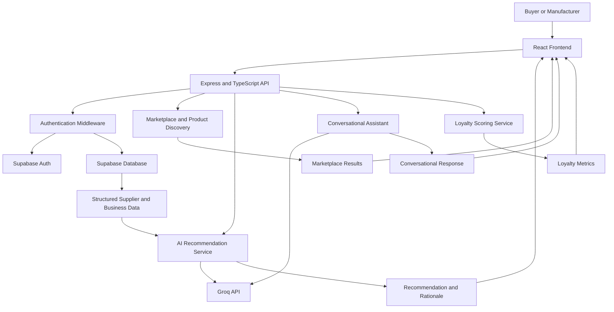

# Sourcingo — AI-Powered B2B Manufacturer Sourcing

**Discover manufacturers. Compare suppliers. Make smarter procurement decisions.**

Website: YOUR_WEBSITE_URL — Replace with your deployed website URL.

Project PPT: https://docs.google.com/presentation/d/1_6h8nnF6j_0A-YwI6qLTD8TqZVzYyA9v/edit?usp=sharing&ouid=108919743515555346478&rtpof=true&sd=true

Sourcingo is a B2B industrial sourcing platform designed to connect buyers with manufacturers, simplify supplier discovery, and support smarter procurement decisions through AI-assisted recommendations.


Sourcingo is a B2B industrial sourcing platform designed to connect buyers with manufacturers, with a focus on simplifying supplier discovery and procurement for Indian businesses and MSMEs.

The platform combines a manufacturer marketplace, buyer and manufacturer accounts, product discovery, AI-assisted procurement recommendations, loyalty scoring, and a conversational sourcing assistant in one workflow.

> **Project status:** Under active development. Some features require Supabase schema configuration, environment variables, and testing before deployment.

---

## Table of Contents

- [Overview](#overview)
- [Problem Statement](#problem-statement)
- [Our Solution](#our-solution)
- [Key Features](#key-features)
- [How It Works](#how-it-works)
- [Technology Stack](#technology-stack)
- [Architecture](#architecture)
- [Project Structure](#project-structure)
- [Getting Started](#getting-started)
- [Environment Variables](#environment-variables)
- [API Reference](#api-reference)
- [Database Design](#database-design)
- [AI and Recommendation Engine](#ai-and-recommendation-engine)
- [Security](#security)
- [Roadmap](#roadmap)
- [Contributing](#contributing)
- [License](#license)

---

## Overview

Traditional industrial procurement often involves fragmented supplier directories, manual research, repeated negotiations, and limited visibility into manufacturer capabilities. Smaller manufacturers may also struggle to reach relevant buyers and communicate their offerings effectively.

Sourcingo aims to make this process more accessible through a digital marketplace that helps buyers discover manufacturers and evaluate potential suppliers using structured business information and AI-assisted recommendations.

### Built for two sides of the marketplace

**Buyers**
- Discover manufacturers and browse industrial products.
- Filter products using available categories, prices, and location criteria.
- Review supplier and product information.
- Receive AI-assisted manufacturer recommendations.
- Access buyer profiles and loyalty-related information.

**Manufacturers**
- Create manufacturer accounts and maintain business profiles.
- Present products and manufacturing capabilities.
- Make product information discoverable to buyers.
- Participate in a structured digital sourcing workflow.

---

## Problem Statement

Industrial sourcing can be unnecessarily difficult for both buyers and manufacturers.

- **Fragmented discovery:** Finding relevant suppliers can require searching across multiple directories and channels.
- **Information asymmetry:** Buyers may have difficulty comparing suppliers using consistent business information.
- **Time-consuming evaluation:** Procurement decisions involve balancing delivery expectations, business requirements, and supplier suitability.
- **Limited visibility for MSMEs:** Smaller manufacturers need better ways to present their products and capabilities to potential buyers.
- **Manual decision-making:** Evaluating several suppliers can be repetitive without structured comparison and decision support.

## Our Solution

Sourcingo brings supplier discovery and procurement assistance into a single platform.

It combines a structured marketplace with AI-assisted recommendation logic, role-based workflows, and a Supabase-backed data layer. The goal is to help buyers move from discovering potential suppliers to evaluating which manufacturer best fits their requirements.

---

## Key Features

### 1. Buyer and Manufacturer Authentication

- Separate buyer and manufacturer account roles.
- Email and password authentication through Supabase Auth.
- Role information associated with user profiles.
- Authenticated API requests using bearer access tokens.
- Profile and business information retrieval.

### 2. Manufacturer and Product Marketplace

- Browse active industrial products.
- View product details, including category, material, specifications, price, minimum order quantity (MOQ), lead time, certifications, and available product imagery where provided.
- Filter product listings using supported criteria such as category, price range, city, and state.
- Retrieve manufacturer information associated with product listings.
- Support role-specific marketplace workflows.

### 3. AI-Powered Manufacturer Recommendations

Sourcingo includes an AI-assisted recommendation service designed to help buyers evaluate manufacturers against procurement preferences.

The current backend retrieves manufacturer records from Supabase, prepares supplier attributes, and passes the structured data and buyer preferences to the recommendation service.

The service generates:
- A recommended manufacturer.
- A concise recommendation headline.
- A rationale explaining the recommendation.
- A runner-up manufacturer and an explanation of the alternative.

Recommendations depend on the quality and completeness of the supplier data available to the application.

### 4. Conversational Procurement Assistant

The chat service supports natural-language sourcing conversations and accepts chat history to maintain conversational context.

It is designed to help users express procurement requirements and understand supplier options without relying entirely on manual filtering.

The backend integrates with Groq for language-model functionality. AI-generated information should be treated as decision support, not a substitute for independently verifying commercial details.

### 5. Buyer Loyalty Scoring

Sourcingo includes a dedicated loyalty-scoring service based on available order and payment history.

The scoring logic evaluates eligible payment obligations and calculates metrics such as:
- On-time payment rate.
- Average payment delay.
- Outstanding overdue balance.
- Number of orders evaluated.
- A calculated loyalty score when sufficient valid history exists.

The implementation excludes cancelled, canceled, and disputed orders from evaluation and avoids assigning a score when there is no valid history.

### 6. Buyer and Business Profiles

- Retrieve the authenticated user's profile.
- Associate a user with a business record.
- Retrieve role-specific buyer or manufacturer details.
- Support profile and business registration workflows through the backend.

### 7. Secure, Modular Backend

- Express API with TypeScript.
- Request validation using Zod in supported routes.
- Authentication middleware and role checks.
- Helmet security headers.
- Configurable CORS.
- Rate limiting on authentication routes.
- User-scoped Supabase clients that allow database Row Level Security (RLS) policies to apply.

---

## How It Works



The frontend communicates with the Express API. The backend handles authentication, validation, business logic, and database access. AI services are used for recommendation and conversational capabilities, while loyalty scoring is implemented as application-side calculation logic.

---

## Technology Stack

| Layer | Technologies |
|---|---|
| Frontend | React 19, TypeScript, Vite |
| Styling | Tailwind CSS 4 |
| UI utilities | Lucide React, `clsx`, `tailwind-merge` |
| Backend | Node.js, Express 5, TypeScript |
| Database | Supabase / PostgreSQL |
| Authentication | Supabase Auth |
| Input validation | Zod |
| AI integration | Groq SDK |
| Security | Helmet, CORS, Express Rate Limit |
| Development | npm, `tsx`, TypeScript |

---

## Architecture

Sourcingo uses a modular frontend and backend structure.

**Frontend**
- React-based user interface.
- API client for communicating with backend endpoints.
- Role-specific views and components.
- TypeScript types for application data.

**Backend**
- Express server with centralized route registration.
- Authentication middleware for protected endpoints.
- Supabase clients for public and user-scoped database access.
- Separate services for AI recommendations, conversational assistance, and loyalty scoring.

**Database and authentication**
- Supabase Auth manages account authentication.
- PostgreSQL stores application records.
- User-scoped database requests forward the authenticated access token so configured RLS policies can enforce access permissions.

**AI services**
- Groq provides language-model access for recommendation and chat workflows.
- Manufacturer recommendations use structured manufacturer attributes and buyer preferences.
- Loyalty scoring uses application-side business rules rather than relying on the language model.

---

## Project Structure

The repository is organized into separate frontend and backend applications.

```text
Sourcingo/
├── backend/
│   ├── src/
│   │   ├── lib/
│   │   │   └── supabase.ts
│   │   ├── middleware/
│   │   │   └── auth.ts
│   │   ├── routes/
│   │   │   ├── auth.routes.ts
│   │   │   ├── profile.routes.ts
│   │   │   ├── marketplace.routes.ts
│   │   │   ├── loyalty.routes.ts
│   │   │   ├── recommendationRoutes.ts
│   │   │   └── chat.routes.ts
│   │   ├── services/
│   │   │   ├── aiService.ts
│   │   │   ├── chatService.ts
│   │   │   └── loyaltyScore.ts
│   │   └── server.ts
│   ├── package.json
│   └── tsconfig.json
├── frontend/
│   ├── src/
│   ├── package.json
│   └── index.html
├── package.json
└── README.md
```

*This is a high-level structure showing the main files and modules. Additional components, configuration files, and route implementations may exist in the repository.*

---

## Getting Started

Follow these steps to run Sourcingo locally.

### Prerequisites

Install the following:

- [Node.js](https://nodejs.org/) — use a current LTS version compatible with the project's dependencies.
- npm, which is included with Node.js.
- A [Supabase](https://supabase.com/) project.
- A [Groq API key](https://console.groq.com/) for AI-powered recommendations and chat.

### 1. Clone the repository

```bash
git clone https://github.com/Divya-Singhal07/Sourcingo.git
cd Sourcingo
```

### 2. Install frontend dependencies

```bash
cd frontend
npm install
cd ..
```

### 3. Install backend dependencies

```bash
cd backend
npm install
cd ..
```

### 4. Configure environment variables

Create a `.env` file inside the `backend/` directory.

```env
PORT=5000
FRONTEND_URL=http://localhost:5173

SUPABASE_URL=https://YOUR_PROJECT_ID.supabase.co
SUPABASE_PUBLISHABLE_KEY=your_supabase_publishable_key

GROQ_API_KEY=your_groq_api_key
```

Replace the example values with your own credentials. Do not commit real API keys or secrets to Git.

### 5. Configure Supabase

In your Supabase project:

1. Configure authentication providers and email confirmation settings as required.
2. Create the database tables and relationships expected by the backend.
3. Configure Row Level Security policies for user-owned and role-specific data.
4. Verify that the application tables and foreign-key relationships used by the marketplace, profiles, recommendations, and loyalty services exist.
5. Test signup, login, and authenticated database requests.

The backend references tables including `profiles`, `businesses`, `buyers`, `manufacturers`, `products`, `rfqs`, and `order_payments`. Their columns and relationships must match the actual queries in the application.

**Important:** Environment variables alone do not initialize the database schema. Apply the required schema and RLS policies before testing database-backed workflows.

### 6. Start the backend

Open a terminal at the repository root:

```bash
cd backend
npm run dev
```

The backend runs on port `5000` by default, unless configured otherwise.

Check the health endpoint:

```text
http://localhost:5000/api/health
```

A successful response should contain the service status and a timestamp.

### 7. Start the frontend

Open a second terminal:

```bash
cd Sourcingo/frontend
npm run dev
```

Vite will print the local frontend URL, typically:

```text
http://localhost:5173
```

Keep `FRONTEND_URL` in the backend environment aligned with the actual frontend origin. If Vite chooses a different port, update the backend configuration and restart it.

### 8. Build the applications

Frontend production build:

```bash
cd frontend
npm run build
```

Backend TypeScript build:

```bash
cd backend
npm run build
```

The backend build and frontend build should both complete successfully before preparing a deployment.

---

## Environment Variables

| Variable | Required | Purpose |
|---|---|---|
| `PORT` | No | Backend port; defaults to `5000`. |
| `FRONTEND_URL` | Yes | Allowed frontend origin for CORS. |
| `SUPABASE_URL` | Yes | Supabase project URL. |
| `SUPABASE_PUBLISHABLE_KEY` | Yes | Public/publishable Supabase key used by the current backend client. |
| `GROQ_API_KEY` | For AI features | API key for Groq-powered recommendations and chat. |

Do not expose secret keys in frontend environment variables or commit them to the repository. If privileged database operations are introduced, keep service-role credentials server-side and use them only where strictly necessary.

---

## API Reference

The following endpoints are registered by the current backend. Some route-specific request fields and response shapes depend on their implementation.

Base URL for local development:

```text
http://localhost:5000
```

### Health

| Method | Endpoint | Description |
|---|---|---|
| `GET` | `/api/health` | Checks whether the backend is running. |

### Authentication

| Method | Endpoint | Description |
|---|---|---|
| `POST` | `/api/auth/signup` | Creates an account with an email, password, and `buyer` or `manufacturer` role. |
| `POST` | `/api/auth/login` | Authenticates a user with email and password. |

Signup requires a valid email, a password of at least eight characters, and a supported role. Login returns the user and session information when authentication succeeds.

### Profiles

| Method | Endpoint | Description |
|---|---|---|
| `GET` | `/api/profile/me` | Retrieves the authenticated user's profile, business, and role-specific details. |

Profile routes require authentication.

### Marketplace

| Method | Endpoint | Description |
|---|---|---|
| `GET` | `/api/marketplace/products` | Browses active products with supported query filters. |

The product listing supports query parameters such as `category`, `city`, `state`, `minPrice`, and `maxPrice`. The backend applies a result limit to the product query.

### AI Recommendations

| Method | Endpoint | Description |
|---|---|---|
| `POST` | `/api/recommend` | Generates a manufacturer recommendation using buyer preferences and available manufacturer data. |

The recommendation endpoint requires authentication. Its response includes recommendation details and the evaluated manufacturer data.

### Conversational Assistant

| Method | Endpoint | Description |
|---|---|---|
| `POST` | `/api/chat` | Processes a chat message and optional conversation history. |

The request supports a non-empty `message`, optional `chatHistory`, and optional `userProfile`. Message and history limits are validated by the backend.

### Loyalty

| Method | Endpoint | Description |
|---|---|---|
| `/api/loyalty/*` | See route implementation | Loyalty-related endpoints for buyer order/payment metrics and scoring. |

Loyalty routes require authentication, and relevant endpoints enforce buyer-role and ownership checks. Consult `backend/src/routes/loyalty.routes.ts` for the exact available paths and request formats.

---

## Database Design

Sourcingo uses Supabase, which provides PostgreSQL storage and authentication integration.

The backend references the following core entities:

| Entity | Purpose |
|---|---|
| `profiles` | User identity and application role. |
| `businesses` | Business-level information and ownership. |
| `buyers` | Buyer-specific attributes and loyalty information. |
| `manufacturers` | Manufacturer-specific capabilities and delivery-related attributes. |
| `products` | Manufacturer product catalog and commercial specifications. |
| `rfqs` | Buyer requests and order-related information used by the application. |
| `order_payments` | Payment and outstanding-balance information used in loyalty calculations. |

The exact schema, constraints, indexes, and RLS policies should be maintained in the database migration or schema files used by the project. Do not infer that a table is fully configured just because the backend references it.

---

## AI and Recommendation Engine

Sourcingo uses AI to support procurement decisions, not to replace the underlying business data.

### Manufacturer recommendations

The recommendation workflow:

1. Authenticates the buyer.
2. Fetches manufacturer and associated business information from Supabase.
3. Converts available attributes into a structured representation.
4. Combines that information with buyer preferences.
5. Sends the prepared data to the Groq-powered recommendation service.
6. Returns a recommended manufacturer, rationale, and runner-up.

The current implementation derives some recommendation attributes from existing manufacturer fields. These derived values should not be interpreted as independently verified performance metrics unless the underlying data supports them.

### Conversational assistant

The chat backend accepts conversation history and optional user-profile context. It returns an assistant response and updated conversation history, supporting a more natural sourcing experience.

### Loyalty scoring

Loyalty scoring is handled through deterministic TypeScript logic. It evaluates eligible order/payment records, calculates payment-related metrics, and returns no numeric score when there is insufficient valid history.

**Design principle:** AI-generated explanations should be grounded in available records. Commercial information, delivery commitments, certifications, and supplier claims should be verified before a purchasing decision is made.

---

## Security

Security is an important part of the application architecture.

Current backend mechanisms include:

- Supabase authentication.
- Bearer-token authentication middleware for protected routes.
- Role and ownership checks on relevant endpoints.
- User-scoped Supabase clients that forward the user's access token.
- Zod request validation in supported routes.
- Helmet security headers.
- Configurable CORS.
- Rate limiting on authentication endpoints.
- JSON request-body size limits.
- Generic handling for unrecognized routes and server errors.

### Security checklist before deployment

- Configure and test RLS policies for every sensitive table.
- Ensure buyers cannot access another buyer's private records.
- Ensure manufacturers cannot modify records belonging to other businesses.
- Never trust a user role or business ID supplied by the client without server-side verification.
- Keep API keys out of source control and frontend bundles.
- Validate and sanitize all incoming data.
- Review logging to ensure tokens, passwords, and sensitive business information are not exposed.
- Use HTTPS in production.
- Add automated tests for authorization boundaries.

---

## Roadmap

Potential next steps for the project include:

- [ ] Complete and test buyer and manufacturer onboarding.
- [ ] Improve supplier discovery and advanced filtering.
- [ ] Implement buyer-controlled search radius and optional automatic radius expansion.
- [ ] Add clear manufacturer comparison and shortlist workflows.
- [ ] Improve recommendation transparency and data-quality checks.
- [ ] Complete RFQ, quotation, and order lifecycle workflows where required.
- [ ] Add robust integration tests for authentication, marketplace, and loyalty logic.
- [ ] Establish database migrations and reproducible Supabase setup.
- [ ] Add deployment configuration, monitoring, and production error handling.
- [ ] Improve accessibility, responsive behavior, and loading/error states.

The roadmap describes planned improvements; a checklist item should only be marked complete once it has been implemented and verified.

---

## Contributing

Contributions, feedback, and ideas are welcome.

1. Fork the repository.
2. Create a feature branch.
3. Make focused changes that fit the existing architecture.
4. Run the frontend and backend builds.
5. Test affected API endpoints and user workflows.
6. Submit a pull request describing the change and its verification.

For bug reports, include reproduction steps, expected behavior, actual behavior, and relevant sanitized logs. Never include passwords, access tokens, API keys, or private customer data.

---

## License

No license information has been confirmed in this README. Until a license is added to the repository, reuse and redistribution should not be assumed to be permitted.

---

## Acknowledgements

Sourcingo is built with React, TypeScript, Express, Supabase, and Groq, bringing together modern web development, structured business data, and AI-assisted procurement workflows.

**Sourcingo — making industrial sourcing more accessible, structured, and intelligent.**
